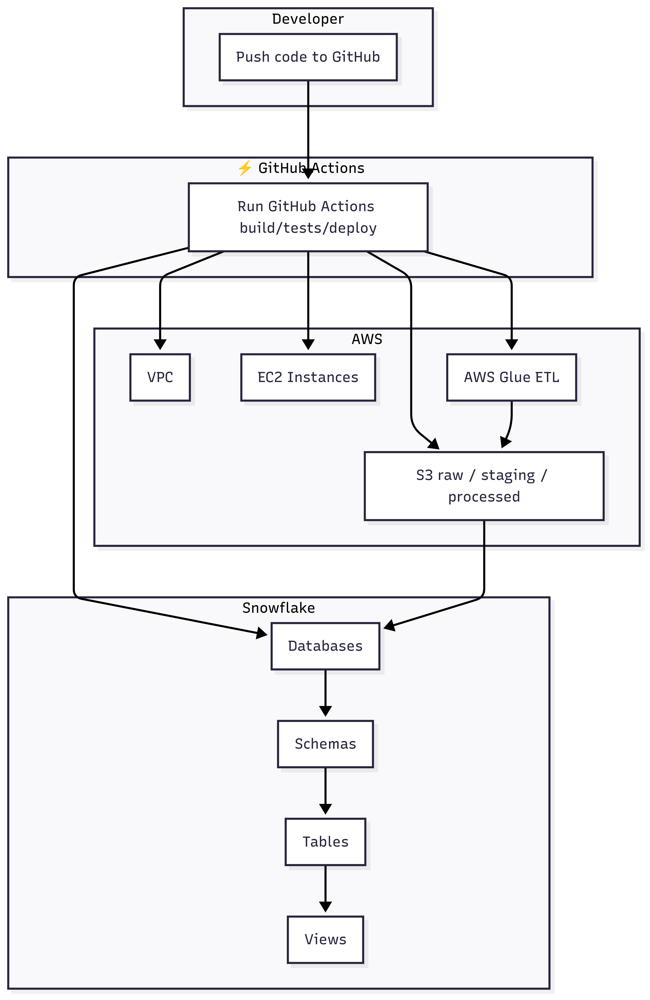

# Introduction to CI/CD

## 1. What is CI/CD?

CI/CD stands for **Continuous Integration (CI)** and **Continuous Delivery/Deployment (CD)**.
It is a **software development practice** that automates the way code changes are tested, integrated, and delivered.

---

## 2. Continuous Integration (CI)

* Developers **merge code frequently** into a shared branch (usually `main`).
* Each change triggers an **automated build and test pipeline**.
* Goal: detect issues **early and quickly**.

### Benefits of CI:

* Detects bugs earlier in the development cycle.
* Prevents "integration hell" (problems caused by merging code at the last moment).
* Encourages smaller, more frequent commits.
* Improves team collaboration.

---

## 3. Continuous Delivery (CD)

* Ensures that code is always in a **deployable state**.
* Every change that passes tests is automatically prepared for release.
* Deployment can be triggered **manually** (with approval).

### Benefits of Continuous Delivery:

* Reduces deployment risk by shipping smaller, incremental changes.
* Faster feedback from staging/testing environments.
* Provides confidence that code is always production-ready.

---

## 4. Continuous Deployment (CDx)

* Goes one step further than delivery.
* Every change that passes the CI pipeline is **automatically deployed** to production **without manual approval**.

### Benefits of Continuous Deployment:

* Rapid feature delivery to end users.
* No waiting for release cycles.
* Keeps production always up to date.

Requires strong **test automation** and **monitoring** to avoid shipping broken code.

---

## 5. CI/CD Pipeline – Step by Step

A typical pipeline includes:

1. **Code Commit**

   * Developer pushes code to GitHub.

2. **Build**

   * Compile or package the application.

3. **Test**

   * Run unit tests, integration tests, security checks.

4. **Deploy (Staging)**

   * Deploy to a staging/testing environment for validation.

5. **Deploy (Production)**

   * Roll out the changes to real users.

---

## 6. Example CI/CD Workflow (High Level)

---

## 7. Why CI/CD Matters?

- Faster feedback → You know if code breaks right after committing.
- Higher quality → Automated tests catch regressions.
- Reduced risk → Smaller, incremental releases are easier to roll back.
- Developer productivity → Less time spent on manual builds/deployments.
- Customer value → Features delivered faster and more reliably.

---

## 8. Tools for CI/CD

* **GitHub Actions** → Built into GitHub, integrates seamlessly.
* **Jenkins** → Popular open-source automation server.
* **GitLab CI/CD** → CI/CD built into GitLab.
* **CircleCI** → Cloud-based CI/CD platform.
* **Azure Pipelines, AWS CodePipeline** → Cloud-native CI/CD services.

---

## Summary of CI/CD

* **CI** = Automatically build and test code when changes are made.
* **CD (Delivery)** = Always keep code in a deployable state, release with approvals.
* **CD (Deployment)** = Automatically deploy every passing change to production.
* **CI/CD Pipelines** help teams release **faster, safer, and with higher quality**.

---

  <a href="./02_github_actions_intro.md"><b>Next Topic : Basics Of Github Actions</b></a>

