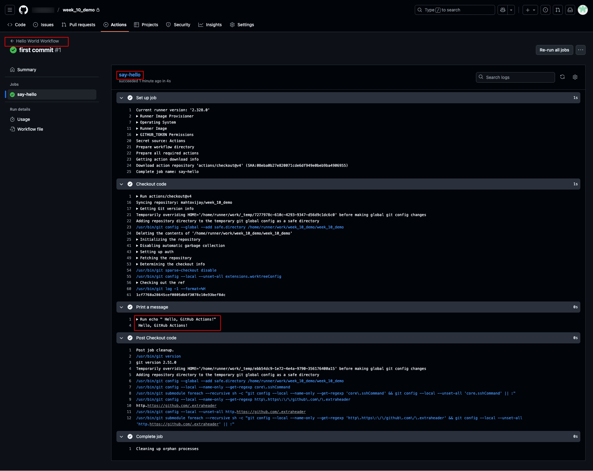
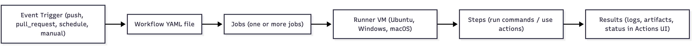

# Introduction to GitHub Actions

## 1. What is GitHub Actions?

GitHub Actions is **GitHub’s built-in CI/CD and automation platform**.

* It allows you to **automate workflows** directly in your repository.
* Runs when **events** (like pushing code, opening a pull request, or creating a release) occur.
* Written in **YAML files**, stored under `.github/workflows/`.
* Supports automation beyond CI/CD: issue labeling, dependency updates, notifications, etc.

Think of GitHub Actions as:
**If X happens in GitHub, then do Y (run pipeline, test code, deploy app, etc.)**

---

## 2. Why Use GitHub Actions?

* **Native to GitHub** → No extra setup, works with your repo instantly.
* **Flexible** → Supports CI/CD for any language, container, or cloud.
* **Reusable** → Use community actions or build your own.
* **Scalable** → Runs on GitHub-hosted or self-hosted runners.
* **Secure** → Integrates with GitHub Secrets and fine-grained permissions.

Common use cases:

* Run **tests** on every pull request.
* **Build & deploy** apps to AWS, Azure, GCP, or on-prem.
* Automate **code quality checks** (linting, formatting).
* Manage **releases** and publish packages (Docker, npm, PyPI).
* Automate **DevOps tasks** (auto-merge PRs, issue labeling).

---

## 3. Core Concepts

### Workflow

* A YAML file that defines an automation process.
* Located in `.github/workflows/`.
* Can contain **one or more jobs**.

### Event (Trigger)

* Defines **when** a workflow runs.
* Examples:

  * `push` → when code is pushed.
  * `pull_request` → when PRs are opened or updated.
  * `schedule` → run on a cron schedule.
  * `workflow_dispatch` → manual trigger via GitHub UI.

### Job

* A set of **steps** executed on the same runner.
* Jobs run in **parallel by default**, but can be sequenced with `needs:`.

### Step

* Individual tasks inside a job.
* Can be:

  * `uses:` → reuse an existing Action.
  * `run:` → execute a shell command.

### Runner

* The **machine** that executes jobs.
* **GitHub-hosted runners**: pre-configured VMs (Ubuntu, Windows, macOS).
* **Self-hosted runners**: your own machine/server, for more control.

### Action

* A **reusable unit** of code for workflows.
* Can be JavaScript, Docker-based, or composite.
* Examples:

  * `actions/checkout@v4` → checkout repository code.
  * `actions/setup-node@v3` → set up Node.js environment.
  * Custom company actions for internal workflows.

---

## 4. Workflow Anatomy

Every workflow has **four major sections**:

### a. Workflow Name

```yaml
name: CI Pipeline
```

### b. Event Trigger (`on:`)

```yaml
on:
  push:
    branches:
      - main
  pull_request:
    branches:
      - main
  workflow_dispatch:
```

### c. Jobs

```yaml
jobs:
  build:
    runs-on: ubuntu-latest
    steps:
      - uses: actions/checkout@v4
      - run: echo "Building project..."
```

### d. Steps

```yaml
steps:
  - name: Run Tests
    run: npm test
```

---

## e. Example: “Hello World” Workflow

```yaml
name: Hello World

on:
  push:
    branches:
      - main

jobs:
  hello:
    runs-on: ubuntu-latest
    steps:
      - name: Checkout code
        uses: actions/checkout@v4

      - name: Print message
        run: echo "Hello, GitHub Actions!"
```

This workflow:

* Runs **on every push to main**.
* Checks out the repo.
* Prints a message in the log.


---

## 6. How Workflows Run



---

## 7. Where to See Workflows

* Go to your repository → **Actions tab**.
* See running workflows, logs, job details.
* Debug failures with logs & annotations.

---

## 8. Key Benefits vs Other CI/CD Tools

* **Integrated with GitHub** (no external setup).
* **Marketplace with 20k+ actions** (for Docker, AWS, Terraform, dbt, etc.).
* **Security-first** (OIDC, Secrets, Permissions).
* **Scales to enterprise** (environments, approval gates, reusable workflows).

---

##  Summary

* GitHub Actions = **automation inside GitHub** for CI/CD + DevOps.
* **Workflows** are YAML-based pipelines, triggered by events.
* **Jobs → Steps → Runners → Actions** form the execution model.
* Use it for **testing, building, deploying, and automating repo tasks**.

---

<div style="text-align: left;">
  <a href="./03_yaml_structrure.md"><b>Next Topic : Deep Into YAML Structure</b></a>
</div>
